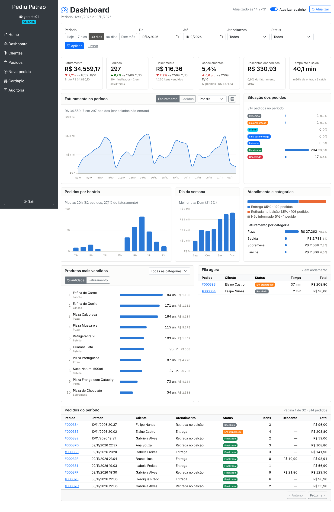
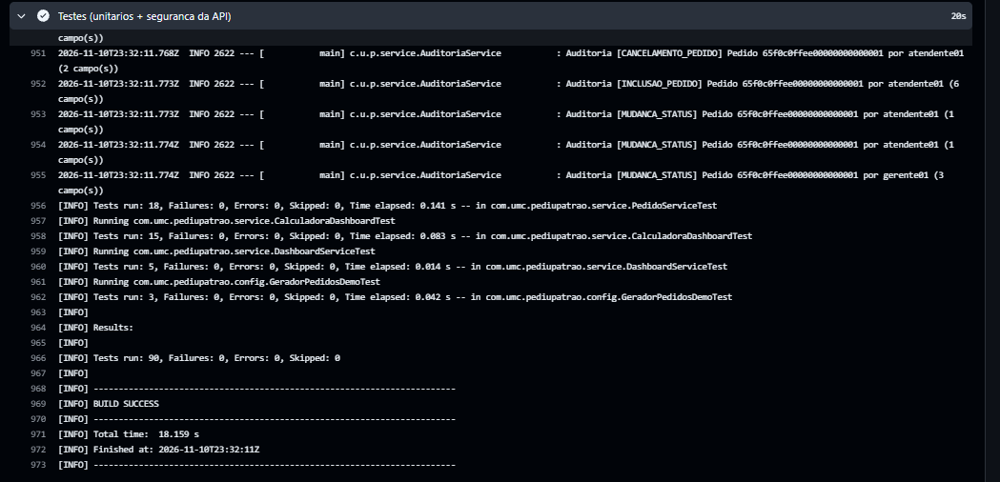

# Dashboard Administrativo — Pediu Patrão

Painel para o responsável pelo estabelecimento (perfis **GERENTE** e **ADMIN**) acompanhar vendas, pedidos e tendências. A tela (`/dashboard`) não tem números no HTML: tudo vem de uma API REST própria (`/api/dashboard/**`), que lê os pedidos no MongoDB.

**Sumário:** [1. Requisitos](#1-requisitos) · [2. Análise e decisões](#2-análise-e-decisões-de-projeto) · [3. Endpoints](#3-documentação-dos-endpoints) · [4. Evidências de testes](#4-evidências-de-testes) · [5. Como executar](#5-como-executar) · [6. Gitflow](#6-gitflow)



---

## 1. Requisitos

### 1.1 Requisitos funcionais

| RF | Descrição | Como foi atendido |
|---|---|---|
| **RF01** | Indicadores gerais de vendas | 6 indicadores: faturamento, pedidos, ticket médio, taxa de cancelamento, descontos concedidos e tempo médio até a saída. Os 4 primeiros mostram a variação contra o período anterior de mesmo tamanho. Endpoint `GET /resumo`. |
| **RF02** | Análise de vendas (gráficos) | Faturamento ou pedidos ao longo do tempo (por dia, semana ou mês), pedidos por horário, faturamento por dia da semana, divisão entrega × retirada e faturamento por categoria. Endpoints `GET /vendas` e `GET /vendas/distribuicao`. |
| **RF03** | Situação dos pedidos | Quantidade e % por status no período, "Fila agora" com pedidos não finalizados e alerta de atraso, e a lista paginada dos pedidos do período. Endpoints `GET /pedidos/status`, `GET /pedidos/em-andamento` e `GET /pedidos`. |
| **RF04** | Produtos mais vendidos | Ranking (top 10) por quantidade ou faturamento, com filtro de categoria e participação no total. Endpoint `GET /produtos/mais-vendidos`. |
| **RF05** | Filtros de consulta | Período (atalhos Hoje / 7 / 30 / 90 dias / Este mês ou datas livres), tipo de atendimento e status. Ranking também filtra por categoria. Os filtros ficam na URL, então recarregar a página mantém a consulta. Opções em `GET /filtros`. |
| **RF06** | Integração com a API | A tela consome os 8 endpoints via `fetch` (`static/js/dashboard.js`). As consultas rodam em paralelo; a anterior é cancelada se o filtro mudar. |
| **RF07** | Atualização e tratamento de dados | Atualização automática a cada 60 s (só com a aba visível) e botão "Atualizar", com horário da última atualização. Estados de carregamento, vazio e erro com "Tentar de novo". Validação de datas no navegador e na API. Pedidos antigos sem itens, valores ou status não derrubam os cálculos. |

### 1.2 Requisitos não funcionais

| RNF | Descrição |
|---|---|
| **RNF01 — Segurança** | Acesso só para ADMIN e GERENTE, em duas camadas (URL no `SecurityConfig` e `@PreAuthorize` no `DashboardService`). Sem login a API responde 401; com outro perfil, 403 (e a tentativa vai para a auditoria). A API é **somente leitura**: qualquer método diferente de GET é negado. |
| **RNF02 — Desempenho** | O recorte por período é feito no MongoDB com índice em `pedidos.entradaEm`. Período máximo de 366 dias por consulta; ranking limitado a 50 itens e páginas a 100 linhas. |
| **RNF03 — Confiabilidade dos números** | Valores em `BigDecimal` (sem erro de arredondamento de `double`), sempre com 2 casas. Indicadores calculados no servidor, nunca no navegador. |
| **RNF04 — Usabilidade** | Layout responsivo (desktop e celular), números no padrão brasileiro (R$ 1.234,56), mensagens de erro em português e tabela alternativa para o gráfico de vendas. |
| **RNF05 — Manutenibilidade** | Regras de cálculo isoladas em uma classe sem Spring (`CalculadoraDashboard`), coberta por testes. A API devolve DTOs próprios, não as entidades. |
| **RNF06 — Testabilidade** | Testes automatizados de cálculo, filtros, service, gerador de dados e segurança/validação da API; CI no GitHub Actions roda tudo a cada push. |
| **RNF07 — Padronização de erros** | Todo erro da API sai no mesmo formato JSON: `{"status": 400, "erro": "mensagem"}`. |

---

## 2. Análise e decisões de projeto

**Definições dos indicadores** (regras de negócio levantadas na análise):

- **Venda** = pedido **não cancelado**, inclusive os que ainda estão em andamento.
- **Faturamento** = soma do `valorTotal` das vendas (já com desconto). **Faturamento bruto** = soma do `subtotal`.
- **Ticket médio** = faturamento ÷ quantidade de vendas.
- **Taxa de cancelamento** = cancelados ÷ total de pedidos do período.
- **Tempo até a saída** = média de minutos entre `entradaEm` e `saidaEm` dos pedidos que já saíram.
- **Comparação** = mesmos indicadores no período imediatamente anterior, com o mesmo número de dias (ex.: 01–07/11 contra 25–31/10).
- **Ranking de produtos** usa o subtotal dos itens (o desconto é do pedido inteiro, não de um item).
- **Atraso** = pedido ainda dentro da pizzaria (Recebido, Em preparação ou Pronto) há mais de 40 min (configurável em `pediupatrao.dashboard.minutos-alerta`).

**Arquitetura** — segue as camadas que o projeto já tinha:

```
dashboard.html + dashboard.js  ──fetch──▶  DashboardApiController  (valida parâmetros → 400)
                                                 │
                                           DashboardService        (@PreAuthorize ADMIN/GERENTE)
                                             │            │
                              PedidoRepository          CalculadoraDashboard
                       (consulta indexada no Mongo)     (cálculos puros, sem Spring)
```

**Por que assim:**

1. **API separada da tela.** A página é só estrutura; os dados vêm da API. Assim a mesma API pode servir outro cliente (app, relatório) e é testável sozinha.
2. **Banco busca, Java calcula.** O MongoDB faz o recorte por período usando índice (`@Query` com `$gte/$lt` em `entradaEm`). Os cálculos ficam em `CalculadoraDashboard`. Para o volume de uma pizzaria (centenas de pedidos por mês) isso é rápido, e as regras ficam testáveis sem banco. Se o volume crescer muito, os cálculos podem migrar para *aggregation pipeline* do MongoDB sem mudar os endpoints.
3. **Período fechado.** `fim=2026-11-10` inclui o dia 10 inteiro; no banco vira `[inicio 00:00, fim+1 00:00)`.
4. **Fila agora não depende do período**, só do status: um pedido de ontem que ainda não saiu precisa aparecer.
5. **Dados de demonstração.** O `GeradorPedidosDemo` cria 90 dias de pedidos realistas (pico 19–21h, fim de semana mais forte, ~6% de cancelamentos, alguns descontos) seguindo as mesmas regras de cálculo e de fluxo de status do `PedidoService`. Só roda quando ligado por variável de ambiente e só uma vez.
6. **Gráficos.** Chart.js 4 salvo no projeto (`static/js/vendor`), sem depender de CDN. Um eixo por gráfico (faturamento e pedidos alternam por botão, não dividem o mesmo gráfico). Ranking e status são barras em HTML, com rótulo e valor escritos, não só cor.

---

## 3. Documentação dos endpoints

**Base:** `http://localhost:8080/api/dashboard` · **Método:** somente `GET` · **Autenticação:** sessão do login do sistema (perfil ADMIN ou GERENTE) · **Resposta:** JSON.

**Convenções da resposta:** valores em reais com 2 casas (`1234.50`); percentuais de 0 a 100 (`12.35` = 12,35%); variação `null` quando o período anterior não tem base; datas ISO (`2026-11-10`, `2026-11-10T19:32:00`) no fuso de São Paulo.

### 3.1 Parâmetros de filtro (comuns)

| Parâmetro | Tipo | Padrão | Regras |
|---|---|---|---|
| `inicio` | data `yyyy-MM-dd` | 29 dias antes de `fim` | Não pode ser depois de `fim` |
| `fim` | data `yyyy-MM-dd` | hoje | Período total de no máximo 366 dias |
| `tipoAtendimento` | `ENTREGA` \| `RETIRADA` | todos | — |
| `status` | `RECEBIDO` \| `EM_PREPARACAO` \| `PRONTO` \| `SAIU_PARA_ENTREGA` \| `RETIRADO` \| `FINALIZADO` \| `CANCELADO` | todos | — |

### 3.2 Erros possíveis (todos os endpoints)

| HTTP | Quando | Corpo |
|---|---|---|
| 400 | `inicio` depois de `fim` | `{"status":400,"erro":"A data inicial não pode ser posterior à data final."}` |
| 400 | Período maior que 366 dias | `{"status":400,"erro":"O período consultado pode ter no máximo 366 dias."}` |
| 400 | Data em outro formato, enum inexistente ou número inválido | `{"status":400,"erro":"Requisição inválida: verifique os campos e valores enviados."}` |
| 400 | `limite`, `pagina` ou `tamanho` fora da faixa | `{"status":400,"erro":"O parâmetro 'limite' deve ficar entre 1 e 50."}` |
| 401 | Sem login | corpo vazio |
| 403 | Perfil ATENDENTE, ou método diferente de GET | `{"status":403,"erro":"Seu perfil não tem permissão para esta operação."}` |

### 3.3 Resumo das rotas

| Rota | RF | Parâmetros próprios |
|---|---|---|
| `GET /resumo` | RF01 | filtros comuns |
| `GET /vendas` | RF02 | filtros + `agrupamento` |
| `GET /vendas/distribuicao` | RF02 | filtros comuns |
| `GET /pedidos/status` | RF03 | `inicio`, `fim`, `tipoAtendimento` |
| `GET /pedidos/em-andamento` | RF03 | `tipoAtendimento` (sem período) |
| `GET /pedidos` | RF03/RF05 | filtros + `pagina`, `tamanho` |
| `GET /produtos/mais-vendidos` | RF04 | `inicio`, `fim`, `tipoAtendimento`, `categoria`, `criterio`, `limite` |
| `GET /filtros` | RF05 | nenhum |

Os exemplos abaixo são respostas reais, geradas com os dados de demonstração.

---

#### `GET /api/dashboard/resumo` — indicadores gerais (RF01)

```
GET /api/dashboard/resumo?inicio=2026-11-01&fim=2026-11-07
```

```json
{
  "periodo": { "inicio": "2026-11-01", "fim": "2026-11-07", "dias": 7 },
  "totalPedidos": 71,
  "pedidosValidos": 68,
  "pedidosFinalizados": 67,
  "pedidosEmAndamento": 0,
  "pedidosCancelados": 3,
  "taxaCancelamento": 4.23,
  "faturamentoBruto": 7542.20,
  "totalDescontos": 80.41,
  "faturamento": 7461.79,
  "ticketMedio": 109.73,
  "valorCancelado": 282.60,
  "itensVendidos": 244,
  "tempoMedioSaidaMinutos": 40.0,
  "comparacao": {
    "periodoAnterior": { "inicio": "2026-10-25", "fim": "2026-10-31", "dias": 7 },
    "faturamento": 8935.00,
    "variacaoFaturamento": -16.49,
    "pedidosValidos": 76,
    "variacaoPedidos": -10.53,
    "ticketMedio": 117.57,
    "variacaoTicketMedio": -6.67,
    "taxaCancelamento": 5.00
  },
  "geradoEm": "2026-11-10T20:40:00"
}
```

`tempoMedioSaidaMinutos` vem `null` se nenhum pedido do período saiu.

---

#### `GET /api/dashboard/vendas` — série de vendas (RF02)

| Parâmetro | Valores | Padrão |
|---|---|---|
| `agrupamento` | `DIA`, `SEMANA` (começa na segunda), `MES` | `DIA` |

Todos os dias/semanas/meses do período aparecem, inclusive os sem venda (valor zero). Cancelados não entram.

```
GET /api/dashboard/vendas?inicio=2026-11-01&fim=2026-11-03&agrupamento=DIA
```

```json
{
  "periodo": { "inicio": "2026-11-01", "fim": "2026-11-03", "dias": 3 },
  "agrupamento": "DIA",
  "totalPedidos": 28,
  "totalFaturamento": 2948.75,
  "pontos": [
    { "chave": "2026-11-01", "rotulo": "01/11", "pedidos": 16, "faturamento": 1560.75, "ticketMedio": 97.55 },
    { "chave": "2026-11-02", "rotulo": "02/11", "pedidos": 3,  "faturamento": 347.80,  "ticketMedio": 115.93 },
    { "chave": "2026-11-03", "rotulo": "03/11", "pedidos": 9,  "faturamento": 1040.20, "ticketMedio": 115.58 }
  ]
}
```

Com `SEMANA` a chave é a segunda-feira (`2026-11-02`, rótulo `Sem. 02/11`); com `MES`, `2026-11` (rótulo `nov/2026`).

---

#### `GET /api/dashboard/vendas/distribuicao` — horário, dia da semana, atendimento e categoria (RF02)

Cada lista é de "fatias" `{chave, rotulo, pedidos, faturamento, percentual}`. `porHora` sempre tem 24 itens (00h a 23h) e `porDiaSemana` 7 (segunda a domingo). Em `porCategoria` o percentual é sobre o total vendido em itens.

```
GET /api/dashboard/vendas/distribuicao?inicio=2026-11-01&fim=2026-11-07
```

```json
{
  "periodo": { "inicio": "2026-11-01", "fim": "2026-11-07", "dias": 7 },
  "porHora": [
    { "chave": "00", "rotulo": "00h", "pedidos": 0, "faturamento": 0.00, "percentual": 0.00 },
    "… 24 itens …"
  ],
  "porDiaSemana": [
    { "chave": "MONDAY",  "rotulo": "Seg", "pedidos": 3, "faturamento": 347.80,  "percentual": 4.66 },
    { "chave": "TUESDAY", "rotulo": "Ter", "pedidos": 9, "faturamento": 1040.20, "percentual": 13.94 },
    "… 7 itens …"
  ],
  "porTipoAtendimento": [
    { "chave": "ENTREGA",  "rotulo": "Entrega",            "pedidos": 35, "faturamento": 3704.58, "percentual": 49.65 },
    { "chave": "RETIRADA", "rotulo": "Retirada no balcão", "pedidos": 32, "faturamento": 3757.21, "percentual": 50.35 }
  ],
  "porCategoria": [
    { "chave": "Pizza",     "rotulo": "Pizza",     "pedidos": 67, "faturamento": 5914.70, "percentual": 78.42 },
    { "chave": "Sobremesa", "rotulo": "Sobremesa", "pedidos": 10, "faturamento": 658.00,  "percentual": 8.72 }
  ]
}
```

Pedidos sem tipo de atendimento (registros antigos) aparecem como `"chave": "NAO_INFORMADO"`.

---

#### `GET /api/dashboard/pedidos/status` — situação no período (RF03)

Sempre traz os 7 status na ordem do fluxo, inclusive os com zero.

```
GET /api/dashboard/pedidos/status?inicio=2026-11-01&fim=2026-11-07
```

```json
{
  "periodo": { "inicio": "2026-11-01", "fim": "2026-11-07", "dias": 7 },
  "total": 71,
  "porStatus": [
    { "status": "RECEBIDO",   "rotulo": "Recebido",   "quantidade": 0,  "valor": 0.00,    "percentual": 0.00 },
    "…",
    { "status": "FINALIZADO", "rotulo": "Finalizado", "quantidade": 67, "valor": 7461.79, "percentual": 94.37 },
    { "status": "CANCELADO",  "rotulo": "Cancelado",  "quantidade": 3,  "valor": 282.60,  "percentual": 4.23 }
  ]
}
```

---

#### `GET /api/dashboard/pedidos/em-andamento` — fila atual (RF03)

Pedidos não finalizados nem cancelados, do mais antigo para o mais novo. Não usa período.

```
GET /api/dashboard/pedidos/em-andamento
```

```json
{
  "limiteMinutos": 40,
  "total": 2,
  "atrasados": 0,
  "pedidos": [
    {
      "id": "673000000000000000000383", "codigo": "000383", "clienteNome": "Elaine Castro",
      "status": "EM_PREPARACAO", "statusRotulo": "Em preparação", "tipoAtendimento": "ENTREGA",
      "entradaEm": "2026-11-10T20:02:39", "minutosDesdeEntrada": 37, "atrasado": false, "valorTotal": 208.80
    }
  ]
}
```

---

#### `GET /api/dashboard/pedidos` — pedidos do período, paginados (RF03/RF05)

| Parâmetro | Faixa | Padrão |
|---|---|---|
| `pagina` | 0 ou mais | `0` |
| `tamanho` | 1 a 100 | `10` |

```
GET /api/dashboard/pedidos?inicio=2026-11-01&fim=2026-11-07&tamanho=1
```

```json
{
  "pagina": 0, "tamanho": 1, "totalElementos": 71, "totalPaginas": 71,
  "conteudo": [
    {
      "id": "673000000000000000000362", "codigo": "000362", "entradaEm": "2026-11-07T22:43:43",
      "clienteNome": "Gabriela Alves", "tipoAtendimento": "RETIRADA", "tipoAtendimentoRotulo": "Retirada no balcão",
      "status": "FINALIZADO", "statusRotulo": "Finalizado", "quantidadeItens": 11,
      "valorDesconto": 0.00, "valorTotal": 114.90, "registradoPor": "demo"
    }
  ]
}
```

Página além do fim devolve `conteudo: []` (não é erro).

---

#### `GET /api/dashboard/produtos/mais-vendidos` — ranking (RF04)

| Parâmetro | Valores | Padrão |
|---|---|---|
| `criterio` | `QUANTIDADE`, `FATURAMENTO` | `QUANTIDADE` |
| `categoria` | categoria do cardápio (campo `tipo` do produto), sem diferenciar maiúsculas | todas |
| `limite` | 1 a 50 | `10` |

Empate é desfeito pelo outro critério. `participacao` = faturamento do produto ÷ `totalItens`.

```
GET /api/dashboard/produtos/mais-vendidos?inicio=2026-11-01&fim=2026-11-07&criterio=FATURAMENTO&limite=2
```

```json
{
  "periodo": { "inicio": "2026-11-01", "fim": "2026-11-07", "dias": 7 },
  "criterio": "FATURAMENTO",
  "categoria": null,
  "totalItens": 7542.20,
  "produtos": [
    { "posicao": 1, "produtoId": "prod1", "nome": "Pizza Calabresa",  "categoria": "Pizza",
      "quantidade": 38, "pedidos": 28, "faturamento": 1896.20, "participacao": 25.14 },
    { "posicao": 2, "produtoId": "prod3", "nome": "Pizza Portuguesa", "categoria": "Pizza",
      "quantidade": 19, "pedidos": 15, "faturamento": 1043.10, "participacao": 13.83 }
  ]
}
```

---

#### `GET /api/dashboard/filtros` — opções para a tela (RF05)

```json
{
  "inicioPadrao": "2026-10-12",
  "fimPadrao": "2026-11-10",
  "diasMaximos": 366,
  "status": [ { "valor": "RECEBIDO", "rotulo": "Recebido" }, "…" ],
  "tiposAtendimento": [ { "valor": "ENTREGA", "rotulo": "Entrega" }, { "valor": "RETIRADA", "rotulo": "Retirada no balcão" } ],
  "categorias": [ "Bebida", "Lanche", "Pizza", "Sobremesa" ],
  "agrupamentos": [ { "valor": "DIA", "rotulo": "Por dia" }, "…" ],
  "criteriosRanking": [ { "valor": "QUANTIDADE", "rotulo": "Quantidade vendida" }, { "valor": "FATURAMENTO", "rotulo": "Faturamento" } ]
}
```

---

## 4. Evidências de testes

### 4.1 Testes automatizados

Rodam com `mvnw test` e no GitHub Actions (`.github/workflows/ci.yml`) a cada push.

| Classe | O que prova | Testes |
|---|---|---|
| `CalculadoraDashboardTest` | Cada indicador conferido contra valores calculados à mão; cancelados fora das vendas; período sem dados não divide por zero; pedidos antigos com campos nulos; séries por dia/semana/mês com dias vazios; atraso só antes da saída; ranking e paginação | 15 |
| `FiltroDashboardTest` | Período padrão de 30 dias, dia final incluído, `inicio > fim` e período > 366 dias recusados, período anterior com mesmo tamanho | 7 |
| `DashboardServiceTest` | Consulta ao banco com as datas certas (período atual e anterior), filtros aplicados, fila busca só status não finalizados, categoria vinda do cardápio | 5 |
| `GeradorPedidosDemoTest` | Dados de demonstração respeitam o cálculo de valores, o limite de 20% de desconto e o fluxo de status; nada no futuro | 3 |
| `DashboardApiTest` | 401 sem login; 403 para ATENDENTE e para POST; 200 para GERENTE e ADMIN; 400 com mensagem para datas invertidas, formato errado, enum inválido e limites de paginação/ranking | 9 |

**Resultado no GitHub Actions (10/11/2026):** 90 testes do projeto (51 anteriores + 39 do dashboard), 0 falhas, `BUILD SUCCESS`.



### 4.2 Validações da API (chamadas reais)

Arquivo: [`evidencias/validacoes-api.txt`](evidencias/validacoes-api.txt)

| Requisição | Resposta |
|---|---|
| `GET /resumo?inicio=2026-11-10&fim=2026-11-01` | 400 — "A data inicial não pode ser posterior à data final." |
| `GET /resumo?inicio=2024-01-01&fim=2026-11-10` | 400 — "O período consultado pode ter no máximo 366 dias." |
| `GET /resumo?inicio=10/11/2026` | 400 — "Requisição inválida: verifique os campos e valores enviados." |
| `GET /vendas?agrupamento=ANO` | 400 — "Requisição inválida: verifique os campos e valores enviados." |
| `GET /pedidos?tamanho=500` | 400 — "O parâmetro 'tamanho' deve ficar entre 1 e 100." |
| `GET /produtos/mais-vendidos?limite=0` | 400 — "O parâmetro 'limite' deve ficar entre 1 e 50." |

### 4.3 Testes da tela

| Cenário | Resultado esperado | Evidência |
|---|---|---|
| Abrir o dashboard (últimos 30 dias) | Indicadores, gráficos, ranking, fila e pedidos carregados | [01](evidencias/01-dashboard-completo.png) |
| Atalho "7 dias" + Atendimento "Entrega" + botão de tabela | Todos os blocos refeitos com o filtro; URL guarda os filtros; tabela do gráfico aberta | [02](evidencias/02-filtro-7dias-entrega.png) |
| Ranking por faturamento, categoria Pizza | Só pizzas, ordenadas por R$ | [03](evidencias/03-ranking-faturamento-pizza.png) |
| Agrupamento "Por semana" (90 dias) | Série semanal | [04](evidencias/04-vendas-por-semana.png) |
| Data inicial depois da final | Mensagem no formulário, API não é chamada | [05](evidencias/05-validacao-datas.png) |
| Período sem pedidos | Zeros e mensagens "Nenhuma venda no período" | [06](evidencias/06-periodo-sem-dados.png) |
| API fora do ar / erro 500 | Alerta com a mensagem da API e botão "Tentar de novo" | [07](evidencias/07-erro-api.png) |
| Tela de celular (390 px) | Blocos empilhados, sem rolagem lateral | [09](evidencias/09-celular.png) |

As capturas foram feitas com o código do dashboard rodando sobre os dados do gerador de demonstração.

**Teste manual de permissão:** logado como `atendente01`, abrir `http://localhost:8080/dashboard` → 403; o menu não mostra "Dashboard". Com `gerente01` ou `admin` o painel abre.

---

## 5. Como executar

1. Configure o banco como antes (`SPRING_DATA_MONGODB_URI` com o seu cluster).
2. **Primeira vez:** gere o histórico de demonstração, senão os gráficos ficam vazios:

   ```cmd
   set PEDIUPATRAO_GERAR_PEDIDOS=true
   mvnw spring-boot:run
   ```

   No log aparece `… pedidos de demonstração gerados (90 dias).` Nas próximas execuções ele não gera de novo. Para refazer, apague no MongoDB os pedidos com `registradoPor: "demo"`.
3. Entre com `gerente01` (ou `admin`) e clique em **Dashboard** no menu.

| Propriedade | Variável de ambiente | Padrão |
|---|---|---|
| `pediupatrao.demo.gerar-pedidos` | `PEDIUPATRAO_GERAR_PEDIDOS` | `false` |
| `pediupatrao.demo.dias` | — | `90` |
| `pediupatrao.dashboard.minutos-alerta` | `PEDIUPATRAO_MINUTOS_ALERTA` | `40` |

Os pedidos de demonstração são gravados direto no banco e **não** geram auditoria (são carga de dados, não operação de usuário).

---

## 6. Gitflow

| Branch | Papel |
|---|---|
| `main` | Versão entregue (tag `v2.0.0`) |
| `develop` | Integração |
| `feature/dashboard-api` | Endpoints, regras de cálculo, segurança e testes da API |
| `feature/dashboard-frontend` | Tela, gráficos e evidências |
| `release/2.0.0` | Fechamento da versão (documentação) antes de ir para a `main` |

Fluxo: `feature/*` → `develop` (merge `--no-ff`) → `release/2.0.0` → `main` + tag, e `release` de volta para `develop`.

### Arquivos principais

| Camada | Arquivo |
|---|---|
| API | `controller/DashboardApiController.java` |
| Regras | `service/DashboardService.java`, `service/CalculadoraDashboard.java` |
| Filtro e DTOs | `dto/FiltroDashboard.java`, `dto/DashboardDto.java` |
| Banco | `repository/PedidoRepository.java` (consultas por período e status), índice em `entity/Pedido.java` |
| Segurança e erros | `config/SecurityConfig.java`, `excecao/ParametroInvalidoException.java`, `excecao/TratamentoErrosApi.java` |
| Dados de demonstração | `config/GeradorPedidosDemo.java` |
| Tela | `templates/dashboard.html`, `static/js/dashboard.js`, `static/css/dashboard.css` |
| Testes | `src/test/.../CalculadoraDashboardTest`, `FiltroDashboardTest`, `DashboardServiceTest`, `GeradorPedidosDemoTest`, `DashboardApiTest` |
